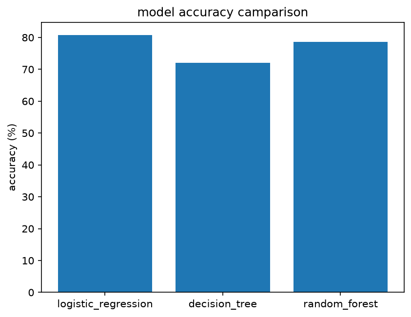

# Customer Churn Prediction (Telco)

Predicts whether a telecom customer will churn (leave the company) from their demographics, services and billing details. Compares three classification models to see which model is giving better perdictions: Logistic Regression, Decision Tree and Random Forest.

## Dataset
- IBM sample Telco Customer Churn data, from Kaggle: [blastchar/telco-customer-churn](https://www.kaggle.com/datasets/blastchar/telco-customer-churn)
- 7,043 customers, 21 columns (19 features plus the `Churn` target, with `customerID` dropped)
- Features: demographics, phone and internet services, contract type, payment method, tenure, monthly and total charges
- Target: `Churn` (Yes/No, encoded as 1/0). Roughly a quarter of customers churn, so the classes are imbalanced.

## Workflow
1. **Cleaning:** converted `TotalCharges` to numeric (blank entries filled with 0) and dropped `customerID`
2. **Target encoding:** `Churn` Yes/No mapped to 1/0
3. **Split:** stratified 80/20 train-test split (`random_state=42`) so both sets keep the same churn rate
4. **Encoding:** one-hot encoding of categorical columns with `pd.get_dummies`
5. **Scaling:** `StandardScaler`, fit on the training set only to avoid data leakage
6. **Models:** Logistic Regression (`max_iter=1000`), Decision Tree and Random Forest (`random_state=42`)
7. **Evaluation:** accuracy, precision, recall, F1 and confusion matrix on the test set

## Results (test set, %)

| Model | Accuracy | Precision | Recall | F1 |
|-------|----------|-----------|--------|-----|
| Logistic Regression | 80.69 | 65.83 | 56.68 | 60.91 |
| Decision Tree | 72.10 | 47.54 | 49.19 | 48.35 |
| Random Forest | 78.63 | 62.54 | 48.66 | 54.73 |

## visual commparison



## Key takeaways
- **Logistic Regression performed best** on accuracy and F1, so the simple baseline beat the tree-based models here.
- **The Decision Tree overfits** and is the weakest model on every metric.
- **Recall is the weak spot.** Every model has recall below 60%, meaning it misses a large share of customers who actually churn. Since catching churners is the business goal, accuracy alone flatters the models: predicting "no churn" for everyone would already score about 73%.

## Possible improvements
- Handle class imbalance with `class_weight="balanced"` or SMOTE to raise recall
- Tune the decision threshold and report ROC-AUC and PR-AUC
- Hyperparameter tuning with cross-validation
- Try gradient boosting (XGBoost / LightGBM)
- Add feature importance or SHAP to explain what drives churn
- Encode the full dataset before splitting so train and test columns always match

## Tech stack
Python, pandas, scikit-learn

## How to run
```bash
git clone https://github.com/deepikabharti1/customer-churn-prediction.git
cd customer-churn-prediction
pip install -r requirements.txt
python customer-churn-project.py
```

## Author
Deepika Bharti · [GitHub](https://github.com/deepikabharti1)
